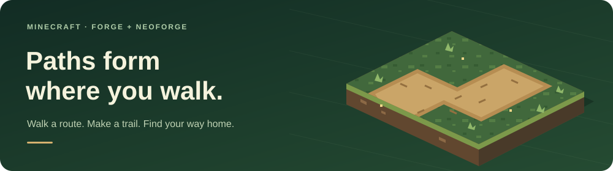

# Safepaths

<p align="center">
  
</p>

Turn the routes you use into trails. Walk faster on roads, let unused paths return to nature, and choose how your world changes.

[](https://www.curseforge.com/minecraft/mc-mods/safepaths)
[](https://modrinth.com/mod/safepaths)
[](https://github.com/ahm3tak1f616/Safepaths/releases)

[Install](#install) · [Settings](#settings) · [Compatibility](#compatibility) · [Build from source](https://github.com/ahm3tak1f616/Safepaths#development) · [Wiki](https://github.com/ahm3tak1f616/Safepaths/wiki)

<table>
<tr>
<td width="50%" valign="top">
<h3>👣 Natural trails</h3>
Grass, dirt, sand, and other supported ground become paths after repeated use. The default is <strong>20 passes within one Minecraft day</strong>.
</td>
<td width="50%" valign="top">
<h3>⚡ Faster roads</h3>
Dirt paths and gravel roads give a <strong>20% speed bonus</strong> by default. Add your own road blocks and adjust the bonus.
</td>
</tr>
<tr>
<td valign="top">
<h3>🌿 Paths grow back</h3>
After <strong>three Minecraft days without use</strong>, tracked paths restore their original terrain. Placed and shovel-made paths do not get a decay timer automatically.
</td>
<td valign="top">
<h3>🏘️ Colony support</h3>
MineColonies citizens can form paths too. Claimed land follows colony permissions; farmland, block entities, and MineColonies blocks are protected. <strong>MineColonies is optional.</strong>
</td>
</tr>
</table>

## Install

Choose the jar that matches **both** your Minecraft version and loader:

| Minecraft | Loader | Java | File ending |
| --- | --- | --- | --- |
| **1.21.1** | NeoForge 21.1.235+ | 21 | `-1.21.1-neoforge.jar` |
| **1.20.1** | Forge 47.3.0+ | 17 | `-1.20.1-forge.jar` |

1. Install the matching loader and download Safepaths from a link above.
2. Put **one matching Safepaths jar** in your instance's `mods` folder.
3. Start the game and walk a short route back and forth to try it.

**Playing on a server?** Install Safepaths on the server. Clients do not need it to use the paths or speed bonus. Settings are controlled by the server owner.

**Updating?** Back up your world and replace the previous Safepaths jar. Keep only one installed version.

## Settings

Open **Mods → Safepaths → Config**, or edit `config/safepaths-common.toml`. On a dedicated server, edit the server's file and restart; the client menu cannot change its settings.

<details>
<summary><strong>Default settings (TOML)</strong></summary>

```toml
["Path Settings"]
requiredPasses = 20
constructionTime = 24000
decayTime = 72000
enableSpeedBoost = true
speedMultiplier = 0.2
```

`speedMultiplier = 0.2` adds 20% movement speed. Time values use game ticks: **24,000 ticks = one Minecraft day** at normal tick speed. The construction window starts with the first counted pass.

</details>

**Permanent roads:** map a block to itself, such as `minecraft:stone_bricks -> minecraft:stone_bricks`. It gains the road speed bonus without changing or decaying. Gravel already has this rule.

**Passes:** move between blocks to count more footsteps. Standing still or jumping in place does not build a path. If restoring sand or gravel would make it fall, the path waits for support.

[All settings](https://github.com/ahm3tak1f616/Safepaths/wiki/Configuration-Guide) · [Conversion editor](https://github.com/ahm3tak1f616/Safepaths/wiki/In-Game-Configuration-and-GUI) · [Troubleshooting](https://github.com/ahm3tak1f616/Safepaths/wiki/FAQ-and-Troubleshooting)

## Compatibility

Safepaths works on its own. These integrations are optional:

| Mod | What Safepaths adds |
| --- | --- |
| **MineColonies** | Citizen-made paths and colony permission checks. |
| **Oh The Biomes We've Gone** | Default conversions for selected lush and sandy soils. |
| **Biomes O' Plenty** | A default conversion for origin grass. |
| **Regions Unexplored** | Default conversions for peat, silt, and chalk soils. |

Other soils and road materials can be added through the conversion editor or [datapack tags](https://github.com/ahm3tak1f616/Safepaths/wiki/Block-and-Entity-Tags). Each optional mod must match your Minecraft version and loader.

## Help and support

[**Report a bug**](https://github.com/ahm3tak1f616/Safepaths/issues) with your Minecraft, loader, and Safepaths versions, reproduction steps, and a relevant log or screenshot.

[Wiki](https://github.com/ahm3tak1f616/Safepaths/wiki) · [Changelog](CHANGELOG.md) · [Support development on Patreon](https://www.patreon.com/ahmetakif616)

**Modpacks are welcome with credit.** All Rights Reserved; standalone redistribution is not permitted. See [LICENSE](LICENSE).

## Development

### Build from source

Install **JDK 17 and JDK 21**, and run the root wrapper with **Java 21**. In IntelliJ, set the root Gradle JVM to Java 21. The build selects Java 17 for Forge and Java 21 for NeoForge.

**Windows / PowerShell**

```powershell
git clone https://github.com/ahm3tak1f616/Safepaths.git
cd Safepaths
.\gradlew.bat build --console=plain
```

**Linux / macOS**

```bash
git clone https://github.com/ahm3tak1f616/Safepaths.git
cd Safepaths
./gradlew build --console=plain
```

The first build downloads Minecraft and the development dependencies. `build` compiles both editions, runs their GameTests, verifies the jars, and puts the **two production downloads** in the root `build/libs/`:

```text
build/libs/
├── safepaths-<version>-1.20.1-forge.jar
└── safepaths-<version>-1.21.1-neoforge.jar
```

Use these jars in Minecraft. An edition's `-sources.jar` or `-javadoc.jar` is a developer artifact, not an installable mod.

<details>
<summary><strong>More build commands</strong></summary>

Run from the repository root. On Linux and macOS, replace `.\gradlew.bat` with `./gradlew`.

```powershell
# Build and collect both jars without running GameTests
.\gradlew.bat assemble --console=plain

# Build only one edition; output stays in that edition's build/libs/
.\gradlew.bat buildForge --console=plain
.\gradlew.bat buildNeoForge --console=plain

# Test both editions without the optional MineColonies runtime
.\gradlew.bat runGameTestServer -PwithoutMineColonies --console=plain

# Show detailed Gradle deprecation warnings
.\gradlew.bat build --warning-mode=all --console=plain

# Enable detailed Minecraft and loader logs for GameTests
.\gradlew.bat runGameTestServer -PmodLogLevel=debug --console=plain
```

</details>

**Where to edit:** shared behavior and resources live in `common/`. Loader events, screens, and API adapters live in `forge-1.20.1/` and `neoforge-1.21.1/`. Both are maintained on `main`, with one `mod_version` in the root `gradle.properties`.

[Development guide](docs/DEVELOPMENT.md) · [Publish both jars in one release](docs/RELEASING.md)
