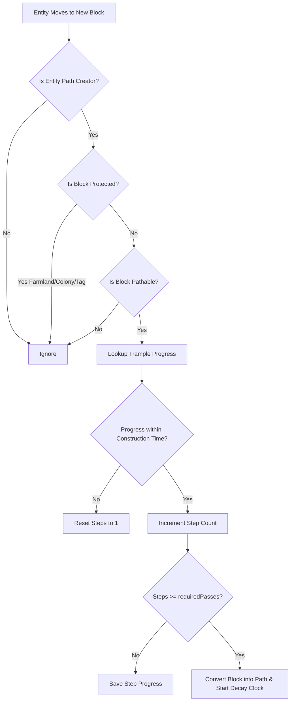

# ⚙️ Core Mechanics

Safepaths creates an organic and realistic pathing experience by modeling foot traffic over time. This page explains the underlying mechanics governing step counting, path conversion, decay, chunk persistence, and safety protections.

---

## 🚶 Step 1: Foot Traffic & Trample Tracking

Whenever a valid path creator (a player or designated NPC) moves across terrain, Safepaths monitors the block directly supporting them.

### Exact Supporting Block Detection (`getOnPos()`)
Safepaths tracks the supporting block underneath the entity using `LivingEntity#getOnPos()`. This accurately targets:
- Full blocks (e.g., grass block, dirt, sand).
- Sunken or sub-blocks (e.g., vanilla dirt paths with a height of `15/16`, mud).
- Blocks walked on while descending slopes or navigating rough terrain.

### Step Deduplication
To prevent a standing or jumping player from artificially generating steps on a single block, Safepaths uses a server-side position memory cache (`LAST_POSITIONS`). Stepping progress is registered **only when an entity physically crosses from one block position into a distinct new block position**.

---

## ⏱️ Step 2: The Construction Time Window

Path creation represents sustained foot traffic rather than sporadic, one-off visits.

- **Config Option**: `constructionTime` (Default: `24000` ticks = 1 in-game Minecraft day).
- When the first step is taken on a block, the game timestamp is recorded (`firstTime`).
- Every subsequent step checks whether `(currentTick - firstTime) <= constructionTime`:
  - **Within Window**: Steps increment normally toward `requiredPasses` (Default: `20` passes).
  - **Expired Window**: If traffic ceased and the window elapsed, old progress automatically expires, resetting the counter back to 1.
- During regular tick maintenance (`onLevelTick`), expired trample records are safely cleaned up from memory.

---

## 🔄 Step 3: Block Transformation Rules

When a block reaches `requiredPasses`, Safepaths determines which path block it should turn into using a strict priority cascade:

1. **Speed-Only Roadway Check**: If the block is registered as a self-mapped roadway (`A -> A`), it returns `null`—it is **never** transformed into a dirt path.
2. **Explicit Custom Conversions**: Custom mappings defined in `customConversions` or via the in-game GUI (e.g. `minecraft:sand -> minecraft:dirt_path` or modded soil mappings).
3. **Vanilla Shovel Pathing State**: Queries vanilla item logic (`ShovelItem.getShovelPathingState(state)`). This automatically supports any third-party mod block that hooks into vanilla shovel flattening behavior.
4. **Keyword Heuristic Fallback**: Inspects block registry IDs for keywords: `grass`, `dirt`, `soil`, `sand`, or `gravel`. Matching blocks convert into standard `minecraft:dirt_path`.

When converted, the block state is updated via `level.setBlockAndUpdate(pos, pathState)`, the trample counter is purged, and a permanent path memory record is created.

---

## ⏳ Step 4: Authentic Decay & Restoration

Paths are not permanent scars on the landscape. If a route falls out of use, nature slowly reclaims it!

### Authentic Memory Storage
When a path is created, Safepaths records:
- The exact **original block state** (e.g. Grass Block, Podzol, Mycelium, Modded Peat Grass).
- The **target path block**.
- The timestamp of the last footstep (`lastTime`).

### Continuous Traffic Refreshing
Whenever a player or path creator walks over an existing path block, its `lastTime` timestamp is refreshed to the current game tick. As long as a path is actively used, **it will never decay**.

### Reversion Logic
- **Config Option**: `decayTime` (Default: `72000` ticks = 3 in-game Minecraft days).
- Every 20 ticks (1 second), the server inspects path records.
- If `(currentTick - data.lastTime) > decayTime`, the path block reverts to its saved `originalState`.
- If the original state was somehow lost or corrupted, Safepaths safely falls back to `minecraft:dirt` to prevent voids or broken blocks.

---

## 💾 Dimension & Chunk Persistence

Safepaths saves all trample and decay data into vanilla dimension data storage using `PathMemorySavedData` (`safepaths_memory.dat`).

### Zero Forced Chunk Loading
Safepaths respects server performance:
- When checking decay timers, Safepaths first verifies `serverLevel.isLoaded(pos)`.
- If a chunk containing an old path is currently **unloaded**, Safepaths **does not force-load the chunk**.
- The record remains safely preserved in world memory until a player returns and loads the chunk, at which point the decay check resumes and restores the block cleanly.

### World Interaction Safety
To prevent phantom paths or duplicate blocks when players manually modify the world:
- **Block Break**: Breaking a path or trample block immediately removes it from Safepaths memory.
- **Explosions**: TNT and Creeper explosions automatically clear path data for all affected blocks.
- **Pistons**: Pushing or pulling blocks with pistons purges tracking at both source and target positions.

---

## 🛡️ Built-in Protections

Safepaths is engineered to protect valuable builds, farms, and colonies:

| Protected Element | Safeguard Mechanism |
| :--- | :--- |
| **Farmland & Crops** | `minecraft:farmland` and any block containing `farmland` in its ID are completely immune. |
| **MineColonies Claims** | Blocks belonging to the `minecolonies` namespace cannot be modified by pathing. |
| **Hostile Mobs & Barbarians** | Barbarians, archer barbarians, chief barbarians, and mobs tagged in `#safepaths:path_blocked` cannot create paths. |
| **Custom Protected Blocks** | Any block tagged under `#safepaths:cannot_become_path` via datapacks is fully protected. |
