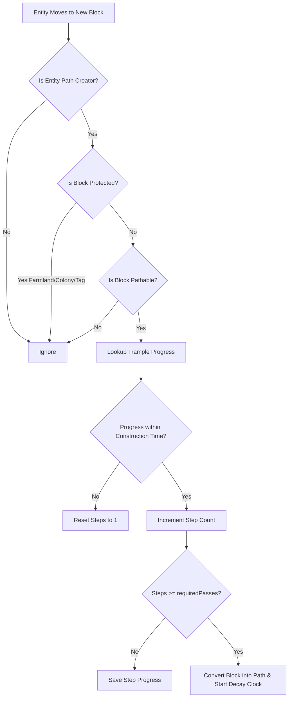

# ⚙️ Core Mechanics

Safepaths creates an organic and realistic pathing experience by modeling foot traffic over time. This page explains the underlying mechanics governing step counting, path conversion, decay, chunk persistence, and safety protections.

---

## 🚶 Step 1: Foot Traffic & Trample Tracking

Whenever a valid path creator (a player or designated NPC) moves across terrain, Safepaths monitors the block directly supporting them.

Footsteps require ground contact. Creative flight does not create paths, and jumping in place does not add construction progress. On MineColonies claims, players need both break and place permissions; civilians must belong to the colony that owns the ground.

### Exact Supporting Block Detection (`getOnPos()`)
Safepaths tracks the supporting block underneath the entity using `LivingEntity#getOnPos()`. This accurately targets:
- Full blocks (e.g., grass block, dirt, sand).
- Sunken or sub-blocks (e.g., vanilla dirt paths with a height of `15/16`, mud).
- Blocks walked on while descending slopes or navigating rough terrain.

### Step Deduplication
To prevent a standing or jumping player from artificially generating steps on a single block, Safepaths uses a server-side position memory cache (`LAST_POSITIONS`). Stepping progress is registered **only when an entity physically crosses from one block position into a distinct new block position**.

---

## ⏱️ Step 2: The Construction Time Window

Path creation represents sustained foot traffic rather than sporadic, one-off visits.

- **Config Option**: `constructionTime` (Default: `24000` ticks = 1 in-game Minecraft day).
- When the first step is taken on a block, the game timestamp is recorded (`firstTime`).
- Every subsequent step checks whether `(currentTick - firstTime) <= constructionTime`:
  - **Within Window**: Steps increment normally toward `requiredPasses` (Default: `20` passes).
  - **Expired Window**: If traffic ceased and the window elapsed, old progress automatically expires, resetting the counter back to 1.
- During regular tick maintenance (`onLevelTick`), expired trample records are safely cleaned up from memory.

---

## 🔄 Step 3: Block Transformation Rules

When a block reaches `requiredPasses`, Safepaths determines which path block it should turn into using a strict priority cascade:

1. **Speed-Only Roadway Check**: If the block is registered as a self-mapped roadway (`A -> A`), it returns `null`—it is **never** transformed into a dirt path.
2. **Explicit Custom Conversions**: Custom mappings defined in `customConversions` or via the in-game GUI (e.g. `minecraft:sand -> minecraft:dirt_path` or modded soil mappings).
3. **Vanilla Shovel Pathing State**: Queries the vanilla shovel flattening table (`ShovelItem.getShovelPathingState(state)`). Modded blocks that only implement tool-action hooks need an explicit conversion or an applicable fallback.
4. **Keyword Heuristic Fallback**: Inspects block registry IDs for keywords: `grass`, `dirt`, `soil`, `sand`, or `gravel`. Matching blocks convert into standard `minecraft:dirt_path`.

After a successful block replacement, the trample counter is purged and a persistent path memory record is created. This record remains until decay or a world modification invalidates it.

Air variants, liquids, non-solid blocks, and block entities are rejected as targets. Blocks with block entities are never trampled. The target must survive at the position, and falling blocks need support; unsafe conversions leave the original ground in place. The first explicit rule for a source wins, and only winning targets are recognized as roads.

---

## ⏳ Step 4: Authentic Decay & Restoration

Paths are not permanent scars on the landscape. If a route falls out of use, nature slowly reclaims it!

### Authentic Memory Storage
When a path is created, Safepaths records:
- The exact **original block state** (e.g. Grass Block, Podzol, Mycelium, Modded Peat Grass).
- The **target path block**.
- The timestamp of the last footstep (`lastTime`).
- The player creator UUID or the owning colony for civilian-created paths, used to recheck permission before decay.

Original block properties, such as stair facing and waterlogging, survive save/load. Legacy saves that only contain a block ID remain readable, but properties already lost by an older version cannot be recovered.

### Continuous Traffic Refreshing
Grounded, authorized traffic refreshes the supporting path block's timestamp, at most once every 20 ticks. Refreshing one block does not refresh an entire road or every block overlapped by the entity's footprint.

### Reversion Logic
- **Config Option**: `decayTime` (Default: `72000` ticks = 3 in-game Minecraft days).
- Every 20 ticks (1 second), the server inspects path records.
- If `(currentTick - data.lastTime) > decayTime`, the path block reverts to its saved `originalState`.
- If the original state was somehow lost or corrupted, Safepaths safely falls back to `minecraft:dirt` to prevent voids or broken blocks.
- If restoration would leave falling terrain unsupported or the original state cannot survive, the path and its memory remain until restoration becomes safe. This includes sand and gravel roads directly over water.
- Replacing a path with a different block invalidates its old record. Decay also rechecks MineColonies ownership and creator permissions before altering claimed ground. Legacy claim records without creator context wait until authorized traffic records a creator.

---

## 💾 Dimension & Chunk Persistence

Safepaths saves all trample and decay data into vanilla dimension data storage using `PathMemorySavedData` (`safepaths_memory.dat`).

### Zero Forced Chunk Loading
Safepaths respects server performance:
- When checking decay timers, Safepaths first verifies `serverLevel.isLoaded(pos)`.
- If a chunk containing an old path is currently **unloaded**, Safepaths **does not force-load the chunk**.
- The record remains safely preserved in world memory until a player returns and loads the chunk, at which point the decay check resumes and restores the block cleanly.

Path positions are indexed by chunk. Maintenance checks chunk availability before visiting its individual records; it does not inspect every unloaded position. Stored records still consume memory, so this is not a guarantee of zero server cost.

### World Interaction Safety
To prevent phantom paths or duplicate blocks when players manually modify the world:
- **Block Break**: Breaking a path or trample block immediately removes it from Safepaths memory.
- **Explosions**: TNT and Creeper explosions automatically clear path data for all affected blocks.
- **Placement**: Player block placement clears tracking for replaced positions, including multi-block placements.
- **Pistons**: Pushing or pulling blocks clears tracking for the complete resolved movement chain, its destinations, and destroyed blocks.

---

## 🛡️ Built-in Protections

Safepaths is engineered to protect valuable builds, farms, and colonies:

| Protected Element | Safeguard Mechanism |
| :--- | :--- |
| **Farmland & Crops** | `minecraft:farmland` and any block containing `farmland` in its ID are completely immune. |
| **MineColonies Claims** | Player traffic requires break/place permissions. Civilian traffic is restricted to its own colony, and decay rechecks saved creator permissions or colony ownership. |
| **Block Entities & Colony Blocks** | Containers, machines, and other block entities cannot be trampled. Blocks in the `minecolonies` namespace remain protected. |
| **Hostile Mobs & Barbarians** | Barbarians, archer barbarians, chief barbarians, and mobs tagged in `#safepaths:path_blocked` cannot create paths. |
| **Custom Protected Blocks** | Any block tagged under `#safepaths:cannot_become_path` via datapacks is fully protected. |
