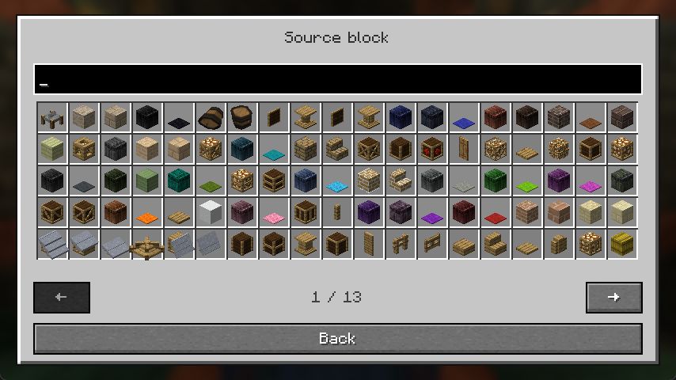

# Settings and conversion editor

Both supported editions use **Mods → Safepaths → Config** to open the same Safepaths layout. While connected to a dedicated server, the menu shows instructions for the server owner instead of editing the remote configuration.

## Settings tabs

| Tab | Controls |
| --- | --- |
| Creation | Enable path creation, required passes, construction window, and whether sneaking prevents creation. |
| Decay | Enable restoration and set the time without authorized traffic before decay. |
| Speed | Enable all road speed bonuses and set the global bonus. |

Numeric fields and toggles share a compact row layout. Time fields show ticks beside the number; speed fields show `%` beside it. Invalid values are highlighted and prevent saving. Hover a control for its explanation; the disabled Done button identifies an invalid setting, including one on another tab.

## Edit a conversion

1. Open **Block Conversions...** from any tab.
2. Select a source-to-road row, or choose **Add Conversion**.
3. Enter source and road block IDs directly, or use **Browse** beside either field.
4. In the block picker, search by block name or registry ID, then choose an item slot. Page arrows and the mouse wheel move through results.
5. Enter an optional speed bonus and choose **Save** to update the draft list.

Source and road icons preview your selection. The picker highlights the current block and explains unsafe choices in tooltips. Where another mod has no translated block name, a readable name is derived from its ID; the full ID remains in the tooltip.

Block picker in the NeoForge 1.21.1 client at 854×480, Auto / effective GUI scale 2. This example includes optional-mod blocks; the available blocks depend on the mods installed.

## Speed fields

Enter **`12.5` or `12,5` for +12.5%**, not `0.125`. The box contains only the number. The percent sign and inherited bonus are outside it.

| Rule field | Meaning |
| --- | --- |
| Empty | Use the global bonus currently entered in settings, including unsaved edits. |
| `0` | No speed bonus for this rule. |
| `12.5` | A +12.5% bonus for this rule. |

The GUI range is 0–500%. The TOML representation is a fraction: `@ 0.125` means +12.5%. See [Road speed](Speed-Boosts-and-Roadways) for shared-target and permanent-road behavior.

## Saving, cancelling, and defaults

- **Save** in the rule editor updates the draft list. **Cancel** or Escape discards that rule edit.
- **Done** in the conversion list returns the draft to settings. It does not write the config file yet. Cancelling the list leaves the parent's draft unchanged.
- The main settings **Done** writes settings and conversions together. The main **Cancel** or Escape discards both.
- **Defaults** in settings resets all settings and conversions after confirmation. In the conversion list it resets only conversions. Neither reset reaches the file until the main Done.
- Incomplete IDs, decimal input, and search text survive window resizing. Unsaved settings survive visits to the conversion editor.

## Valid rules

Air, liquids, non-solid blocks, and blocks with block-entity data cannot be road targets. Sources such as inventories and farmland are protected. World placement must also survive at the position and have safe support. The editor shows the reason a rule cannot be saved and rejects duplicate source IDs.

Rules for missing optional mods stay visible and can be retained as inactive entries. They apply only when both blocks are installed and the rule is safe. Manual TOML duplicates follow the precedence described in [Configuration](Configuration-Guide).
